# Hex Mill gallery

Every parameter Hex Mill offers, shown one at a time. Each image is a real SVG from Hex Mill, so you can open it in Inkscape, plot it, or load it into `hexmill.html` to see its settings.

Only the changes from the base example are listed under each image. The base is a 150 × 105 mm page with 6 mm margins and a 7 × 5 grid, with everything else at its default.

The one addition is a `% Paper` layer holding a white page, so the images read on a dark background. AxiDraw never plots layers named with `%`.

These files are generated. To rebuild them, run `npm run gallery`.

## Contents

- [Working out the size](#working-out-the-size)
- [Page, margins and alignment](#page-margins-and-alignment)
- [Layouts](#layouts)
- [Map edges](#map-edges)
- [Drawing](#drawing)
- [Label numbering](#label-numbering)
- [Label style](#label-style)
- [Decorators](#decorators)
- [Warnings](#warnings)
- [Refused settings](#refused-settings)

## Working out the size

Page, hex size and hex count can't all be set freely, so you fix two and Hex Mill works out the third. All sizes refer to the theoretical lattice and ignore the inset.

### Work out hex count

A4 and 20 mm hexes are fixed. Hex Mill fits as many as it can.

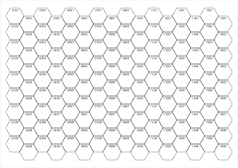

16 × 9, 144 hexes, 779 strokes, 13.12 m pen down

`{"page":{"paper":"A4","width":null,"height":null},"lattice":{"solve":"count","size":20}}`

### Work out hex size

A4 and 9 × 6 hexes are fixed. Hex Mill finds the largest hex that fits.

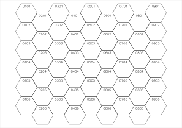

9 × 6, 54 hexes, 291 strokes, 7.62 m pen down

`{"page":{"paper":"A4","width":null,"height":null},"lattice":{"solve":"size","columns":9,"rows":6}}`

### Work out page size

5 × 4 hexes at 22 mm are fixed. The page wraps the map plus its margins.

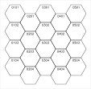

5 × 4, 20 hexes, 109 strokes, 2.00 m pen down

`{"lattice":{"solve":"page","columns":5,"rows":4,"size":22}}`

### Size by flat to flat

20 mm between opposite flat sides.

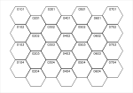

7 × 4, 28 hexes, 155 strokes, 2.56 m pen down

`{"lattice":{"solve":"count","measure":"flat","size":20}}`

### Size by edge length

20 mm along one edge, so a much larger hex.

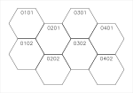

4 × 2, 8 hexes, 42 strokes, 1.25 m pen down

`{"lattice":{"solve":"count","measure":"edge","size":20}}`

### Size by corner to corner

20 mm between opposite corners.

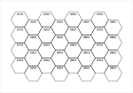

8 × 4, 32 hexes, 176 strokes, 2.54 m pen down

`{"lattice":{"solve":"count","measure":"corner","size":20}}`

## Page, margins and alignment

The blue guides show the margins and the map edge. When hexes don't fill the area inside the margins, alignment decides where the leftover space goes.

### Named paper, portrait

A5 in portrait.

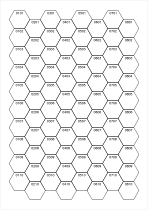

8 × 10, 80 hexes, 436 strokes, 6.65 m pen down

`{"page":{"paper":"A5","orientation":"portrait","width":null,"height":null},"lattice":{"solve":"count","size":18}}`

### Custom paper

A long 200 × 70 mm strip.

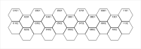

11 × 2, 22 hexes, 114 strokes, 1.79 m pen down

`{"page":{"paper":"Custom","width":200,"height":70},"lattice":{"solve":"count","size":18}}`

### Different margins per side

Wide left and top margins, narrow right and bottom.

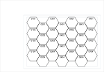

7 × 4, 28 hexes, 155 strokes, 2.06 m pen down

`{"margins":{"top":22,"right":5,"bottom":5,"left":34},"lattice":{"solve":"count","size":16},"decorators":{"guides":true}}`

### Aligned top left

All leftover space goes to the right and bottom.

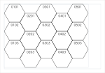

5 × 3, 15 hexes, 78 strokes, 1.78 m pen down

`{"lattice":{"solve":"count","size":26,"align":{"x":"start","y":"start"}},"decorators":{"guides":true}}`

### Centred

The default: leftover space is split evenly.

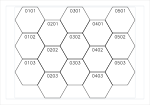

5 × 3, 15 hexes, 78 strokes, 1.78 m pen down

`{"lattice":{"solve":"count","size":26,"align":{"x":"center","y":"center"}},"decorators":{"guides":true}}`

### Aligned bottom right

All leftover space goes to the left and top.

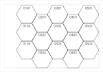

5 × 3, 15 hexes, 78 strokes, 1.78 m pen down

`{"lattice":{"solve":"count","size":26,"align":{"x":"end","y":"end"}},"decorators":{"guides":true}}`

## Layouts

One setting covers orientation and stagger, using the Red Blob Games names. Columns are `q` and rows are `r`, both counted from 0.

### odd-q

Flat-top. Odd columns are shoved down.

7 × 5, 35 hexes, 192 strokes, 2.72 m pen down

`{"lattice":{"layout":"odd-q"}}`

### even-q

Flat-top. Even columns are shoved down.

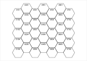

7 × 5, 35 hexes, 192 strokes, 2.72 m pen down

`{"lattice":{"layout":"even-q"}}`

### odd-r

Pointy-top. Odd rows are shoved right.

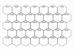

7 × 5, 35 hexes, 192 strokes, 2.94 m pen down

`{"lattice":{"layout":"odd-r"}}`

### even-r

Pointy-top. Even rows are shoved right.

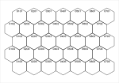

7 × 5, 35 hexes, 192 strokes, 2.94 m pen down

`{"lattice":{"layout":"even-r"}}`

## Map edges

Hexes can stay whole, or be cut along a straight map edge. Cut hexes are real geometry, not an SVG clip, so a plotter draws them correctly.

### Whole hexes

The default, with ragged edges.

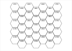

7 × 5, 35 hexes, 192 strokes, 2.72 m pen down

`{}`

### Short lines

Shoved columns lose one hex, which flattens the bottom edge.

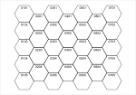

7 × 5, 32 hexes, 176 strokes, 2.70 m pen down

`{"lattice":{"shortLines":true}}`

### Cut ends

The first and last columns are cut in half.

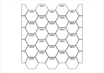

7 × 5, 35 hexes, 145 strokes, 2.42 m pen down

`{"lattice":{"cutEnds":true}}`

### Cut ragged sides

The top and bottom are straight, leaving half-hexes in alternate columns.

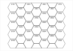

7 × 5, 38 hexes, 182 strokes, 3.03 m pen down

`{"lattice":{"cutRagged":true}}`

### Cut all sides, closed

Cut hexes are closed along the map edge, giving a straight border.

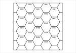

7 × 5, 38 hexes, 135 strokes, 2.70 m pen down

`{"lattice":{"cutEnds":true,"cutRagged":true,"closePartials":true}}`

### Cut all sides, open

Cut hexes are left open, so no border is drawn.

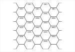

7 × 5, 38 hexes, 135 strokes, 2.39 m pen down

`{"lattice":{"cutEnds":true,"cutRagged":true,"closePartials":false}}`

### Closed, with inset

The closing line respects the inset like every other edge.

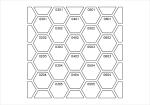

7 × 5, 38 hexes, 135 strokes, 2.42 m pen down

`{"lattice":{"cutEnds":true,"cutRagged":true,"closePartials":true},"render":{"inset":1}}`

### Open, with inset

Open cuts run right to the map edge.

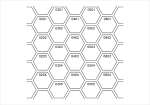

7 × 5, 38 hexes, 135 strokes, 2.18 m pen down

`{"lattice":{"cutEnds":true,"cutRagged":true,"closePartials":false},"render":{"inset":1}}`

### Cut all sides, pointy-top

The same options work in r layouts.

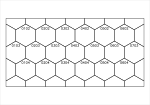

7 × 5, 37 hexes, 123 strokes, 2.71 m pen down

`{"lattice":{"layout":"odd-r","cutEnds":true,"cutRagged":true}}`

## Drawing

An inset `i` draws each hex smaller than its lattice cell. The channel between neighbours is `2i`, and the visible paper gap is `2i` minus the pen width.

### Inset 0.5 mm

A 1 mm channel between hexes.

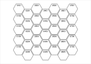

7 × 5, 35 hexes, 192 strokes, 2.60 m pen down

`{"render":{"inset":0.5}}`

### Inset 1.5 mm

A 3 mm channel between hexes.

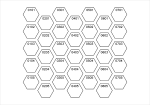

7 × 5, 35 hexes, 192 strokes, 2.36 m pen down

`{"render":{"inset":1.5}}`

### Simplified

Duplicate lines removed and the rest chained into the fewest strokes. Compare the pen-down length with the whole-hex example above.

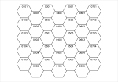

7 × 5, 35 hexes, 191 strokes, 1.92 m pen down

`{"render":{"simplify":true}}`

### Corners only

Short ticks at each corner, 2 mm long by default.

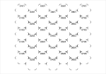

7 × 5, 35 hexes, 367 strokes, 1.51 m pen down

`{"render":{"style":"corners"}}`

### Longer corners

Corner length raised to 3.5 mm.

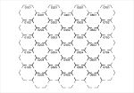

7 × 5, 35 hexes, 367 strokes, 2.14 m pen down

`{"render":{"style":"corners","cornerLength":3.5}}`

### Pen width 0.8 mm

Sets the stroke shown on screen, and the paper gap Hex Mill reports. It doesn't change the geometry.

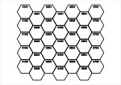

7 × 5, 35 hexes, 192 strokes, 2.72 m pen down

`{"render":{"penWidth":0.8}}`

## Label numbering

Each scheme is a format string with `%c` and `%r` for numbers, `%C` and `%R` for letters, `%h` for half-lines and `%n` for serial numbers.

### Column-row

The classic four-digit form, and the default.

7 × 5, 35 hexes, 192 strokes, 2.72 m pen down

`{"labels":{"preset":"xxyy"}}`

### Letter-number

Lettered columns, numbered rows.

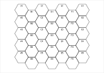

7 × 5, 35 hexes, 167 strokes, 2.38 m pen down

`{"labels":{"preset":"letter-number"}}`

### 18xx, flat-top

Columns are lettered. Numbers step by two down a column and alternate between columns.

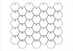

7 × 5, 35 hexes, 170 strokes, 2.41 m pen down

`{"labels":{"preset":"18xx"}}`

### 18xx, pointy-top

Rows are lettered. Numbers step by two along a row and alternate between rows.

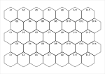

7 × 5, 35 hexes, 180 strokes, 2.63 m pen down

`{"lattice":{"layout":"odd-r"},"labels":{"preset":"18xx"}}`

### Dotted

A separator between column and row.

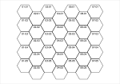

7 × 5, 35 hexes, 227 strokes, 2.74 m pen down

`{"labels":{"preset":"dotted"}}`

### Serial, along rows

One running count.

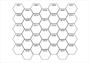

7 × 5, 35 hexes, 182 strokes, 2.73 m pen down

`{"labels":{"preset":"serial"}}`

### Serial, down columns

Counting from 100, down each column.

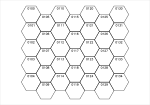

7 × 5, 35 hexes, 182 strokes, 2.64 m pen down

`{"labels":{"preset":"serial","serialOrder":"col","start":{"serial":100}}}`

### Custom format

Literal text works too: here a sheet prefix.

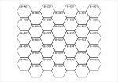

7 × 5, 35 hexes, 342 strokes, 2.88 m pen down

`{"labels":{"preset":"custom","format":"B-%C%02r"}}`

### Past Z: tally

Starting at column 25: Y, Z, AA, BB, CC.

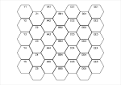

7 × 5, 35 hexes, 232 strokes, 2.52 m pen down

`{"labels":{"preset":"letter-number","letters":"tally","start":{"col":25}}}`

### Past Z: spreadsheet

Starting at column 25: Y, Z, AA, AB, AC.

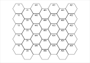

7 × 5, 35 hexes, 242 strokes, 2.50 m pen down

`{"labels":{"preset":"letter-number","letters":"spreadsheet","start":{"col":25}}}`

### Origin top right

Columns count from the right.

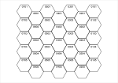

7 × 5, 35 hexes, 192 strokes, 2.72 m pen down

`{"labels":{"origin":"ur"}}`

### Origin bottom left

Rows count up from the bottom.

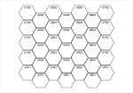

7 × 5, 35 hexes, 192 strokes, 2.72 m pen down

`{"labels":{"origin":"ll"}}`

### Origin bottom right

Both axes are reversed.

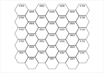

7 × 5, 35 hexes, 192 strokes, 2.72 m pen down

`{"labels":{"origin":"lr"}}`

### Start and step

Columns count 10, 12, 14. Rows count 5, 10, 15.

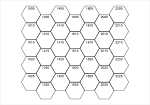

7 × 5, 35 hexes, 180 strokes, 2.67 m pen down

`{"labels":{"start":{"col":10,"row":5},"step":{"col":2,"row":5}}}`

### Every second hex

Fewer labels means far fewer pen lifts.

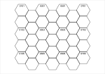

7 × 5, 35 hexes, 86 strokes, 2.27 m pen down

`{"labels":{"every":2}}`

### Label cut hexes

Off by default. Half-hexes at the top number as row 0.

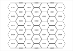

7 × 5, 38 hexes, 208 strokes, 3.16 m pen down

`{"lattice":{"cutRagged":true},"labels":{"labelPartials":true,"distance":0}}`

### No labels

Labels switched off.

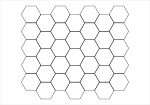

7 × 5, 35 hexes, 35 strokes, 2.05 m pen down

`{"labels":{"enabled":false}}`

## Label style

Labels are stroke fonts drawn as plain paths. Size is the height of a digit in mm. Bearing and distance place the label from the hex centre, and rotation turns it.

### Hershey Script

One of 41 built-in fonts.

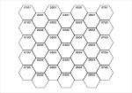

7 × 5, 35 hexes, 525 strokes, 3.26 m pen down

`{"labels":{"font":"HersheyScript1"}}`

### Hershey Gothic

A multi-stroke font, so it takes much longer to plot.

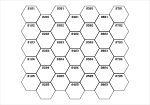

7 × 5, 35 hexes, 1208 strokes, 3.63 m pen down

`{"labels":{"font":"HersheyGothEnglish"}}`

### EMS Tech

One of the modern EMS fonts.

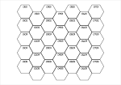

7 × 5, 35 hexes, 175 strokes, 2.75 m pen down

`{"labels":{"font":"EMSTech"}}`

### Digit height 3 mm

The default is about 11% of flat to flat.

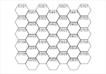

7 × 5, 35 hexes, 192 strokes, 3.11 m pen down

`{"labels":{"size":3}}`

### In the centre

Distance 0.

7 × 5, 35 hexes, 192 strokes, 2.72 m pen down

`{"labels":{"distance":0}}`

### At the bottom

Bearing 180°, measured clockwise from up.

7 × 5, 35 hexes, 192 strokes, 2.72 m pen down

`{"labels":{"bearing":180}}`

### Rotated

Rotation 90°, placed on the right with bearing 90°.

7 × 5, 35 hexes, 192 strokes, 2.72 m pen down

`{"labels":{"rotation":90,"bearing":90,"distance":5}}`

### Anchor start

The text starts at the placement point.

7 × 5, 35 hexes, 262 strokes, 2.83 m pen down

`{"labels":{"anchor":"start","distance":0},"decorators":{"centre":"cross","centreSize":1.5}}`

### Anchor end

The text ends at the placement point.

7 × 5, 35 hexes, 262 strokes, 2.83 m pen down

`{"labels":{"anchor":"end","distance":0},"decorators":{"centre":"cross","centreSize":1.5}}`

## Decorators

Each decorator has its own layer, so it can be plotted separately or switched off in Inkscape.

### Centre dots

A dot is a tiny real path, so it plots.

7 × 5, 35 hexes, 227 strokes, 2.79 m pen down

`{"decorators":{"centre":"dot"}}`

### Centre crosses

Size raised to 2 mm.

7 × 5, 35 hexes, 262 strokes, 2.86 m pen down

`{"decorators":{"centre":"cross","centreSize":2}}`

### Registration marks

Crosses just outside the map corners, for lining up pens or sheets.

7 × 5, 35 hexes, 200 strokes, 2.28 m pen down

`{"margins":{"top":14,"right":14,"bottom":14,"left":14},"decorators":{"registration":true,"registrationOffset":5,"registrationSize":6}}`

### Border

One continuous stroke around the outer edges of the hexes, on its own layer so it can take another pen.

7 × 5, 35 hexes, 193 strokes, 3.17 m pen down

`{"decorators":{"border":true}}`

### Border offset

Moved 3 mm out from inset hexes, around a map with straight cut sides.

7 × 5, 38 hexes, 183 strokes, 3.19 m pen down

`{"lattice":{"cutRagged":true},"render":{"inset":1},"decorators":{"border":true,"borderOffset":3}}`

### Rectangle border

A straight box 2 mm outside the outermost hexes, instead of following their zigzag.

7 × 5, 35 hexes, 193 strokes, 3.14 m pen down

`{"decorators":{"border":true,"borderShape":"rectangle","borderOffset":2}}`

### Guides layer

Margins, map edge and theoretical lattice. Named with `%`, so AxiDraw never plots it.

7 × 5, 35 hexes, 192 strokes, 2.36 m pen down

`{"render":{"inset":1.5},"decorators":{"guides":true}}`

## Warnings

These still produce a file, but Hex Mill tells you about the problem.

### Page exceeds plotter travel

A2 is too big for the AxiDraw SE/A3 either way round. A3 portrait fits, because the plotter software turns it.

15 × 18, 270 hexes, 1464 strokes, 36.27 m pen down

> The page (420 × 594 mm) exceeds the AxiDraw SE/A3 travel of 430 × 297 mm, either way round.

`{"page":{"paper":"A2","orientation":"portrait","width":null,"height":null},"lattice":{"solve":"count","size":30}}`

### Choosing a plotter

NextDraw and AxiDraw models are built in. A3 is too big for a NextDraw 8511.

15 × 9, 135 hexes, 732 strokes, 18.46 m pen down

> The page (420 × 297 mm) exceeds the NextDraw 8511 travel of 300 × 218 mm, either way round.

`{"page":{"paper":"A3","orientation":"landscape","width":null,"height":null},"lattice":{"solve":"count","size":30},"plotter":{"name":"NextDraw 8511","width":300,"height":218}}`

### Custom travel limit

The limit can be set for any other plotter.

7 × 5, 35 hexes, 192 strokes, 2.72 m pen down

> The page (150 × 105 mm) exceeds the custom plotter travel of 120 × 90 mm, either way round.

`{"plotter":{"name":"Custom","width":120,"height":90}}`

### Labels too big

Labels that cross the hex outline are counted.

7 × 5, 35 hexes, 192 strokes, 4.17 m pen down

> 35 labels extend past their hex outline.

`{"labels":{"size":6}}`

### Hexes touch

A 0.2 mm channel is narrower than a 0.5 mm pen.

7 × 5, 35 hexes, 192 strokes, 2.70 m pen down

> At this inset and pen width, neighbouring hexes touch.

`{"render":{"inset":0.1,"penWidth":0.5}}`

### Simplify with an inset

Inset hexes share no lines, so simplify has nothing to do.

7 × 5, 35 hexes, 192 strokes, 2.48 m pen down

> Simplify only applies at inset 0, because inset hexes share no lines.

`{"render":{"inset":1,"simplify":true}}`

### Repeated labels

A format with only a column letter gives every hex in a column the same label.

7 × 5, 35 hexes, 125 strokes, 2.23 m pen down

> 28 labels repeat another hex's label, so this format can't tell those hexes apart.

`{"labels":{"preset":"custom","format":"%C"}}`

### Missing glyph

Characters the font lacks are skipped and named.

7 × 5, 35 hexes, 122 strokes, 2.36 m pen down

> Font lacks: →

`{"labels":{"preset":"custom","format":"%c→%r"}}`

### Border offset too large

Past about half a hex, the offset border would fold over itself in the notches of the ragged edge.

7 × 5, 35 hexes, 192 strokes, 2.72 m pen down

> The border offset is too large for the shape of the map edge, so the border is left out.

`{"decorators":{"border":true,"borderOffset":9}}`

### Registration mark off the page

The margins are too small for the marks.

7 × 5, 35 hexes, 200 strokes, 2.76 m pen down

> A registration mark falls off the page.

`{"decorators":{"registration":true}}`

## Refused settings

Hex Mill won't draw these, and says why.

| Setting | Message |
|---|---|
| Hex size of 0 | Hex size must be greater than 0. |
| Zero columns | Columns and rows must be whole numbers of at least 1. |
| Margins wider than the page | The margins leave no room on the page. |
| Too many hexes | That is 58,830 hexes. The limit is 20,000. |
| Cut ends with only one column | Cutting the ends needs at least two lines of hexes. |
| Inset of half the hex or more | Inset must be at least 0 and less than 10 mm for this hex size. |
| Hex larger than the page | Even one hex does not fit in the available area. |
